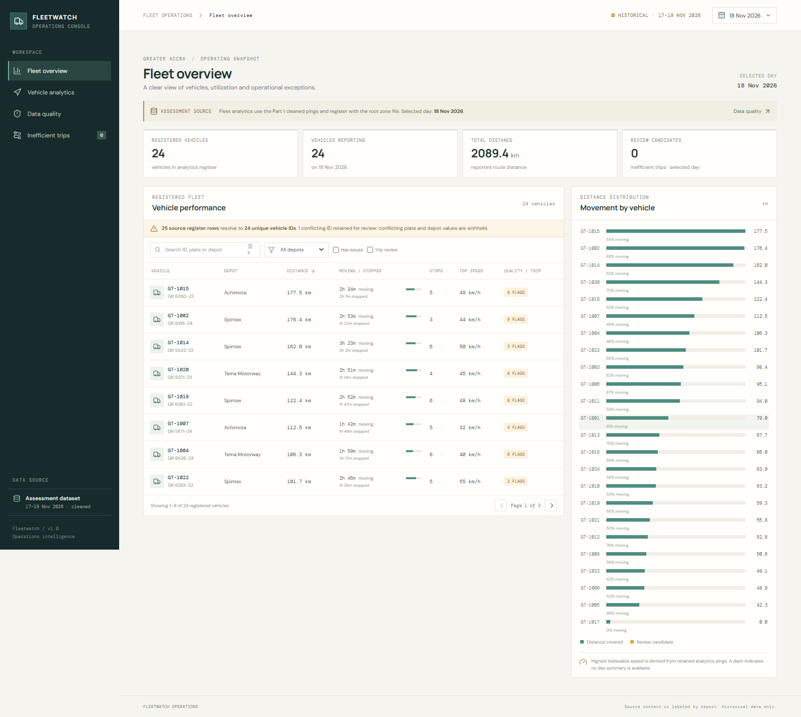

# Fleetwatch — Greater Accra Fleet Analytics

Fleetwatch turns tracker pings into daily fleet metrics, stops, zone events and a vehicle-day route map. This repository includes a deterministic TypeScript cleaning/analytics pipeline, a JSON HTTP API, a React + Leaflet operations dashboard, Docker Compose, and AWS CDK.

> **Dataset note:** `data/raw/` contains a small synthetic example for the fleet analytics pipeline. The assessment `pings.csv` and `vehicles.csv` files are at the repository root and are processed separately by the data-cleaning command below. The committed files in `data/processed/` are demo analytics outputs, not findings about the assessment inputs.

## Run locally

Requirements: Node.js 22+ and Docker Compose (or npm for local development).

```sh
npm ci
npm test
npm run cleaning                 # reads root pings.csv and vehicles.csv; writes auditable outputs beside them
npm run pipeline                 # reads data/raw; writes data/processed
npm run api                      # http://localhost:3000
```

Or start both containers with one command: `npm start` (dashboard at http://localhost:4173, API at http://localhost:3000). For hot reload, use `npm run dev`. The pipeline can also accept input and output directories: `npm run pipeline -- /path/to/raw /path/to/output`. Running it repeatedly replaces its deterministic outputs.

The assessment cleaner is independent of the demo analytics pipeline. `npm run cleaning` writes `pings_clean.csv`, `vehicles_clean.csv`, `rejects.csv`, `data_quality_issues.csv`, `data_quality_summary.json`, and `DATA_QUALITY_LOGBOOK.md` in the repository root. It accepts optional input and output directories: `npm run cleaning -- /path/to/input /path/to/output`. It never overwrites the raw CSV inputs.

## Data and decisions

`npm run pipeline` reads `data/raw/pings.csv`, `vehicles.csv` and `zones.geojson` for the demo fleet analytics flow. It normalizes parseable timestamps to UTC ISO-8601, drops rows with an unknown vehicle, invalid/out-of-Ghana coordinates, invalid timestamps, accuracy above 100 m, or exact duplicates, and retains pings with speed outside 0–160 km/h while marking speed unknown. Every drop or change is recorded with its type, source vehicle/time, reason and action in `data/processed/anomalies.json` and `rejects.csv`; the latter deliberately includes changed as well as dropped rows. Invalid polygon rings are recorded, closed when possible, and unusable geometries are dropped. The assessment cleaner described above uses separate outputs and flags poor accuracy instead of dropping those observations.

Distances use the haversine formula (mean Earth radius 6,371.0088 km). Intervals over 30 minutes are excluded from movement/distance estimates to avoid implying travel across missing data. Movement uses tracker speed ≥5 km/h; contiguous readings below 5 km/h for at least five minutes form a stop. A trip is flagged when it lasts over 60 minutes and covers under 5 km between detected stops. This is a conservative review signal, not a judgment of driver performance.

## Outputs and API

The pipeline writes daily summaries (`summaries.csv`/`.json`), stops, anomalies, rejects, issue counts (`data_quality_summary.csv`), inefficient trips (`inefficient_trips.csv`/`.json`), cleaned zones, and one RFC 7946 GeoJSON route FeatureCollection per vehicle-day under `data/processed/routes/`. Routes are simplified with a 20 m tolerance. Restricted-zone time is estimated only where both endpoints of a ping interval are within a restricted polygon; this can undercount boundary crossings.

| Method / endpoint | Response |
|---|---|
| `GET /vehicles/{vehicle_id}/days/{date}` | Daily distance, moving/stopped time, stop count, speed, quality count, restricted-zone minutes |
| `GET /vehicles/{vehicle_id}/days/{date}/stops` | Stops and zone/depot classification |
| `GET /vehicles/{vehicle_id}/days/{date}/route` | Route and stop GeoJSON features |
| `GET /zones` | Cleaned zone FeatureCollection |
| `GET /anomalies?type=&vehicle_id=` | Filterable data-quality events |
| `GET /fleet?date=YYYY-MM-DD` | Dashboard daily fleet view |
| `GET /inefficient-trips` | Flagged trips and reason |

Errors use `{ "error": { "code": "...", "message": "..." } }`. The dashboard includes sortable/filterable fleet metrics, vehicle route and stop layers, quality groupings, inefficient-trip reasons, loading/empty/error states, and a responsive layout.

## AWS and containers

`Dockerfile.api` and `Dockerfile.dashboard` build independently; Compose runs both locally. `infra/app.ts` defines a VPC, two ECS Fargate services behind load balancers, Cloud Map service discovery, CloudWatch log groups, an encrypted private versioned S3 bucket and an API task role scoped to `PutObject` under `processed/*`. On AWS, the pipeline uploads all exports to that prefix. Deploy with `npx cdk deploy` after configuring AWS credentials and a CDK bootstrap for the target account/region. The dashboard proxies `/api/*` to the API service, so no client-side AWS URL configuration is needed. The starter deployment packages demo inputs; copy the assessment files into the API image/build context and rebuild to analyze them.

See [DESIGN.md](DESIGN.md) for cleaning rationale, scale architecture and next steps.

## Dashboard preview



The preview uses synthetic demo data and map tiles from OpenStreetMap.
